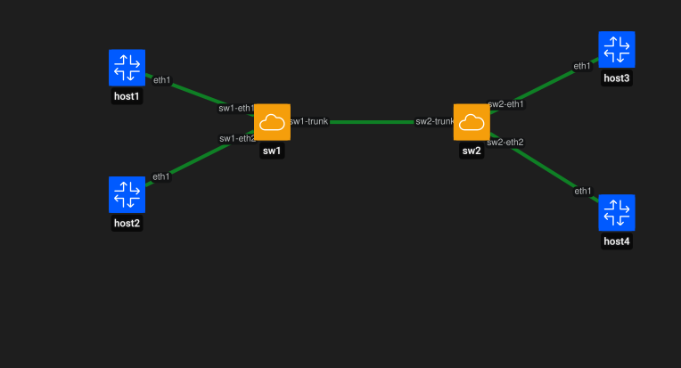

# Containerlab desde cero: 802.1Q y enlaces trunk

Esta guía muestra cómo transportar múltiples VLANs entre dos switches Open vSwitch utilizando un enlace trunk 802.1Q.

El objetivo es comprobar que:

- los hosts de una misma VLAN pueden comunicarse a través de varios switches;
- un único enlace trunk puede transportar varias VLANs;
- las VLANs continúan aisladas entre sí mientras no exista routing entre ellas.

---

# 1. Topología

Se utilizarán cuatro hosts Linux y dos switches Open vSwitch:



La idea es que:

```text
VLAN 10
host1 <------------------------> host3

VLAN 20
host2 <------------------------> host4
```

utilizando el mismo enlace entre `sw1` y `sw2`.

---

# 2. Crear los switches OVS

Crear los bridges:

```bash
sudo ovs-vsctl add-br sw1
sudo ovs-vsctl add-br sw2
```

Verificar:

```bash
sudo ovs-vsctl show
```

Deberían aparecer:

```text
Bridge sw1
Bridge sw2
```

---

# 3. Crear la topología de Containerlab

Crear el archivo:

```text
topologies/ovs-trunk.clab.yml
```

Contenido:

```yaml
name: ovs-trunk

topology:
  nodes:
    host1:
      kind: linux
      image: alpine:3.20

    host2:
      kind: linux
      image: alpine:3.20

    host3:
      kind: linux
      image: alpine:3.20

    host4:
      kind: linux
      image: alpine:3.20

    sw1:
      kind: ovs-bridge

    sw2:
      kind: ovs-bridge

  links:
    - endpoints: ["host1:eth1", "sw1:sw1-eth1"]
    - endpoints: ["host2:eth1", "sw1:sw1-eth2"]

    - endpoints: ["sw1:sw1-trunk", "sw2:sw2-trunk"]

    - endpoints: ["host3:eth1", "sw2:sw2-eth1"]
    - endpoints: ["host4:eth1", "sw2:sw2-eth2"]
```

Los nombres de las interfaces OVS se mantienen únicos porque ambos bridges viven en el namespace de red del host.

---

# 4. Desplegar la topología

Ejecutar:

```bash
sudo containerlab deploy -t topologies/ovs-trunk.clab.yml
```

Inspeccionar:

```bash
sudo containerlab inspect -t topologies/ovs-trunk.clab.yml
```

---

# 5. Verificar los puertos de los switches

En `sw1`:

```bash
sudo ovs-vsctl list-ports sw1
```

Resultado esperado:

```text
sw1-eth1
sw1-eth2
sw1-trunk
```

En `sw2`:

```bash
sudo ovs-vsctl list-ports sw2
```

Resultado esperado:

```text
sw2-eth1
sw2-eth2
sw2-trunk
```

Interpretación:

```text
sw1-eth1   -> host1
sw1-eth2   -> host2
sw1-trunk  -> sw2

sw2-eth1   -> host3
sw2-eth2   -> host4
sw2-trunk  -> sw1
```

---

# 6. Configurar puertos access

Asignar VLAN 10 y VLAN 20 en `sw1`:

```bash
sudo ovs-vsctl set port sw1-eth1 tag=10
sudo ovs-vsctl set port sw1-eth2 tag=20
```

Asignar VLAN 10 y VLAN 20 en `sw2`:

```bash
sudo ovs-vsctl set port sw2-eth1 tag=10
sudo ovs-vsctl set port sw2-eth2 tag=20
```

La asignación queda:

```text
host1 -> VLAN 10
host2 -> VLAN 20
host3 -> VLAN 10
host4 -> VLAN 20
```

---

# 7. Configurar el trunk 802.1Q

Permitir VLAN 10 y VLAN 20 sobre el enlace entre switches.

En `sw1`:

```bash
sudo ovs-vsctl set port sw1-trunk trunks=10,20
```

En `sw2`:

```bash
sudo ovs-vsctl set port sw2-trunk trunks=10,20
```

La topología lógica queda:

```text
host1 VLAN 10 ----\
                   sw1 ======== sw2 ---- host3 VLAN 10
host2 VLAN 20 ----/      trunk       \---- host4 VLAN 20
                         10,20
```

---

# 8. Verificar la configuración OVS

Ejecutar:

```bash
sudo ovs-vsctl show
```

En `sw1` deberían aparecer valores similares a:

```text
Port sw1-eth1
    tag: 10

Port sw1-eth2
    tag: 20

Port sw1-trunk
    trunks: [10, 20]
```

En `sw2`:

```text
Port sw2-eth1
    tag: 10

Port sw2-eth2
    tag: 20

Port sw2-trunk
    trunks: [10, 20]
```

---

# 9. Configurar direccionamiento IPv4

Se utilizarán dos redes diferentes:

```text
VLAN 10 -> 10.10.10.0/24
VLAN 20 -> 10.20.20.0/24
```

Asignación:

| Host | VLAN | Dirección |
|---|---:|---|
| host1 | 10 | 10.10.10.1/24 |
| host3 | 10 | 10.10.10.3/24 |
| host2 | 20 | 10.20.20.2/24 |
| host4 | 20 | 10.20.20.4/24 |

Configurar `host1`:

```bash
docker exec clab-ovs-trunk-host1 \
  ip addr add 10.10.10.1/24 dev eth1
```

Configurar `host3`:

```bash
docker exec clab-ovs-trunk-host3 \
  ip addr add 10.10.10.3/24 dev eth1
```

Configurar `host2`:

```bash
docker exec clab-ovs-trunk-host2 \
  ip addr add 10.20.20.2/24 dev eth1
```

Configurar `host4`:

```bash
docker exec clab-ovs-trunk-host4 \
  ip addr add 10.20.20.4/24 dev eth1
```

---

# 10. Verificar VLAN 10

## Forma 1: prueba directa

Desde `host1` hacia `host3`:

```bash
docker exec clab-ovs-trunk-host1 \
  ping -c 3 10.10.10.3
```

Resultado esperado:

```text
3 packets transmitted
3 packets received
0% packet loss
```

## Forma 2: prueba interactiva

Entrar a `host1`:

```bash
docker exec -it clab-ovs-trunk-host1 sh
```

Dentro:

```bash
ping 10.10.10.3
```

El ping continúa hasta interrumpirlo manualmente con:

```text
Ctrl + C
```

Salir del contenedor:

```bash
exit
```

---

# 11. Verificar VLAN 20

## Forma 1: prueba directa

Desde `host2` hacia `host4`:

```bash
docker exec clab-ovs-trunk-host2 \
  ping -c 3 10.20.20.4
```

Resultado esperado:

```text
3 packets transmitted
3 packets received
0% packet loss
```

## Forma 2: prueba interactiva

Entrar a `host2`:

```bash
docker exec -it clab-ovs-trunk-host2 sh
```

Dentro:

```bash
ping 10.20.20.4
```

Interrumpir con:

```text
Ctrl + C
```

Salir:

```bash
exit
```

---

# 12. Interpretar el funcionamiento del trunk

La comunicación de VLAN 10 sigue este camino:

```text
host1
  |
sw1-eth1
  |
 VLAN 10
  |
sw1-trunk
  ||
  || 802.1Q
  ||
sw2-trunk
  |
 VLAN 10
  |
sw2-eth1
  |
host3
```

La comunicación de VLAN 20 utiliza el mismo enlace:

```text
host2
  |
sw1-eth2
  |
 VLAN 20
  |
sw1-trunk
  ||
  || 802.1Q
  ||
sw2-trunk
  |
 VLAN 20
  |
sw2-eth2
  |
host4
```

---

# 13. Probar aislamiento entre VLANs

## Forma 1: prueba directa

Desde `host1`:

```bash
docker exec clab-ovs-trunk-host1 \
  ping -c 3 10.20.20.2
```

El ping debería fallar.

## Forma 2: prueba interactiva

Entrar a `host1`:

```bash
docker exec -it clab-ovs-trunk-host1 sh
```

Ejecutar:

```bash
ping 10.20.20.2
```

Interrumpir:

```text
Ctrl + C
```

Salir:

```bash
exit
```

La comunicación falla porque no existe routing entre VLAN 10 y VLAN 20.

---

# 14. ¿Qué aporta 802.1Q?

Sin un trunk sería necesario utilizar enlaces separados para transportar cada VLAN.

Con 802.1Q, un único enlace puede transportar tráfico perteneciente a múltiples VLANs manteniendo la separación lógica entre ellas.

---

# 15. Destruir el laboratorio

Eliminar los nodos y enlaces de Containerlab:

```bash
sudo containerlab destroy -t topologies/ovs-trunk.clab.yml
```

Los bridges OVS fueron creados manualmente en el host y pueden continuar existiendo.

Comprobar:

```bash
sudo ovs-vsctl show
```

Para eliminarlos:

```bash
sudo ovs-vsctl del-br sw1
sudo ovs-vsctl del-br sw2
```

Verificar nuevamente:

```bash
sudo ovs-vsctl show
```

---

# 16. Resultado

Validaciones realizadas:

```text
Open vSwitch              OK
Dos switches OVS          OK
Cuatro hosts Linux        OK
Puertos access            OK
VLAN 10                   OK
VLAN 20                   OK
Trunk 802.1Q              OK
VLAN 10 sobre trunk       OK
VLAN 20 sobre trunk       OK
Aislamiento entre VLANs   OK
Conectividad ICMP         OK
```