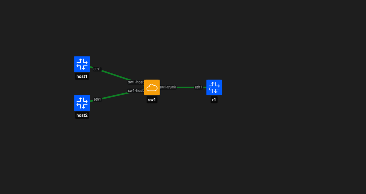

# Containerlab desde cero: routing entre VLANs con FRRouting

Esta guía muestra cómo implementar **routing entre VLANs** utilizando:

- Containerlab;
- Open vSwitch (OVS);
- FRRouting (FRR);
- subinterfaces 802.1Q;
- una topología tipo *router-on-a-stick*.

El objetivo es permitir comunicación entre hosts ubicados en VLANs diferentes mediante un único enlace trunk entre el switch y el router.

---

# 1. Topología



La topología utilizada es:

```text
host1 VLAN 10 ----\
                   sw1 ===== trunk ===== r1
host2 VLAN 20 ----/
```

El router utilizará dos subinterfaces:

```text
eth1.10 -> VLAN 10 -> 10.10.10.1/24
eth1.20 -> VLAN 20 -> 10.20.20.1/24
```

La asignación será:

| Nodo | Interfaz | VLAN | Dirección |
|---|---|---:|---|
| host1 | eth1 | 10 | 10.10.10.10/24 |
| host2 | eth1 | 20 | 10.20.20.20/24 |
| r1 | eth1.10 | 10 | 10.10.10.1/24 |
| r1 | eth1.20 | 20 | 10.20.20.1/24 |

---

# 2. Crear el bridge OVS

Crear el switch virtual:

```bash
sudo ovs-vsctl add-br sw1
```

Verificar:

```bash
sudo ovs-vsctl show
```

Debería aparecer:

```text
Bridge sw1
```

---

# 3. Crear la topología de Containerlab

Crear el archivo:

```text
inter-vlan-routing.clab.yml
```

Contenido:

```yaml
name: inter-vlan-routing

topology:
  nodes:
    host1:
      kind: linux
      image: alpine:3.20

    host2:
      kind: linux
      image: alpine:3.20

    r1:
      kind: frr
      image: quay.io/frrouting/frr:containerlab-10.7.1
      exec:
        - ip link add link eth1 name eth1.10 type vlan id 10
        - ip link add link eth1 name eth1.20 type vlan id 20
        - ip link set eth1 up
        - ip link set eth1.10 up
        - ip link set eth1.20 up

    sw1:
      kind: ovs-bridge

  links:
    - endpoints: ["host1:eth1", "sw1:sw1-host1"]
    - endpoints: ["host2:eth1", "sw1:sw1-host2"]
    - endpoints: ["r1:eth1", "sw1:sw1-trunk"]
```

---

# 4. Entender las subinterfaces VLAN

Estas líneas:

```yaml
- ip link add link eth1 name eth1.10 type vlan id 10
- ip link add link eth1 name eth1.20 type vlan id 20
```

crean dos subinterfaces sobre `eth1`:

```text
eth1
├── eth1.10
└── eth1.20
```

Cada subinterfaz procesa tráfico correspondiente a una VLAN diferente.

La relación es:

```text
eth1.10 -> VLAN 10
eth1.20 -> VLAN 20
```

---

# 5. Desplegar la topología

Ejecutar:

```bash
sudo containerlab deploy -t inter-vlan-routing.clab.yml
```

Inspeccionar:

```bash
sudo containerlab inspect -t inter-vlan-routing.clab.yml
```

---

# 6. Verificar los puertos de OVS

Listar los puertos de `sw1`:

```bash
sudo ovs-vsctl list-ports sw1
```

Resultado esperado:

```text
sw1-host1
sw1-host2
sw1-trunk
```

Interpretación:

```text
sw1-host1 -> host1
sw1-host2 -> host2
sw1-trunk -> r1
```

---

# 7. Configurar los puertos access

Asignar `host1` a VLAN 10:

```bash
sudo ovs-vsctl set port sw1-host1 tag=10
```

Asignar `host2` a VLAN 20:

```bash
sudo ovs-vsctl set port sw1-host2 tag=20
```

---

# 8. Configurar el trunk hacia el router

Permitir VLAN 10 y VLAN 20:

```bash
sudo ovs-vsctl set port sw1-trunk trunks=10,20
```

Verificar:

```bash
sudo ovs-vsctl show
```

La sección de `sw1` debería mostrar:

```text
Port sw1-host1
    tag: 10

Port sw1-host2
    tag: 20

Port sw1-trunk
    trunks: [10, 20]
```

---

# 9. Verificar las subinterfaces en `r1`

Entrar a FRR:

```bash
docker exec -it clab-inter-vlan-routing-r1 vtysh
```

Mostrar interfaces:

```text
show interface brief
```

Deberían aparecer:

```text
eth1
eth1.10
eth1.20
```

Salir:

```text
exit
```

También puede verificarse directamente desde Linux:

```bash
docker exec clab-inter-vlan-routing-r1 ip link show
```

---

# 10. Configurar las IP gateway en FRR

Entrar a `r1`:

```bash
docker exec -it clab-inter-vlan-routing-r1 vtysh
```

Configurar VLAN 10:

```text
configure terminal
interface eth1.10
 ip address 10.10.10.1/24
 no shutdown
exit
```

Configurar VLAN 20:

```text
interface eth1.20
 ip address 10.20.20.1/24
 no shutdown
exit
end
```

Verificar:

```text
show interface brief
```

Deberían aparecer:

```text
eth1.10   up   default   10.10.10.1/24
eth1.20   up   default   10.20.20.1/24
```

Estas direcciones funcionarán como gateway de cada VLAN:

```text
VLAN 10 -> 10.10.10.1
VLAN 20 -> 10.20.20.1
```

Salir:

```text
exit
```

---

# 11. Configurar `host1`

Asignar dirección:

```bash
docker exec clab-inter-vlan-routing-host1 \
  ip addr add 10.10.10.10/24 dev eth1
```

Configurar el gateway:

```bash
docker exec clab-inter-vlan-routing-host1 \
  ip route replace default via 10.10.10.1 dev eth1
```

Verificar:

```bash
docker exec clab-inter-vlan-routing-host1 ip addr show eth1
docker exec clab-inter-vlan-routing-host1 ip route
```

Se espera:

```text
10.10.10.10/24
default via 10.10.10.1 dev eth1
```

---

# 12. Configurar `host2`

Asignar dirección:

```bash
docker exec clab-inter-vlan-routing-host2 \
  ip addr add 10.20.20.20/24 dev eth1
```

Configurar gateway:

```bash
docker exec clab-inter-vlan-routing-host2 \
  ip route replace default via 10.20.20.1 dev eth1
```

Verificar:

```bash
docker exec clab-inter-vlan-routing-host2 ip addr show eth1
docker exec clab-inter-vlan-routing-host2 ip route
```

Se espera:

```text
10.20.20.20/24
default via 10.20.20.1 dev eth1
```

---

# 13. Nota sobre la red de management

Containerlab crea automáticamente una interfaz de management:

```text
eth0
```

Esta interfaz pertenece a la red de gestión de Containerlab y puede tener una ruta por defecto similar a:

```text
default via 172.20.20.1 dev eth0
```

Para que el tráfico del laboratorio utilice el router `r1`, se reemplaza esa ruta por defecto con:

```bash
ip route replace default via <gateway> dev eth1
```

Ejemplo en `host1`:

```bash
docker exec clab-inter-vlan-routing-host1 \
  ip route replace default via 10.10.10.1 dev eth1
```

---

# 14. Probar conectividad con el gateway de VLAN 10

## Forma 1: prueba directa

```bash
docker exec clab-inter-vlan-routing-host1 \
  ping -c 3 10.10.10.1
```

Resultado esperado:

```text
3 packets transmitted
3 packets received
0% packet loss
```

## Forma 2: prueba interactiva

Entrar al contenedor:

```bash
docker exec -it clab-inter-vlan-routing-host1 sh
```

Ejecutar:

```bash
ping 10.10.10.1
```

Interrumpir con:

```text
Ctrl + C
```

Salir:

```bash
exit
```

---

# 15. Probar conectividad con el gateway de VLAN 20

## Forma 1: prueba directa

```bash
docker exec clab-inter-vlan-routing-host2 \
  ping -c 3 10.20.20.1
```

## Forma 2: prueba interactiva

```bash
docker exec -it clab-inter-vlan-routing-host2 sh
```

Dentro:

```bash
ping 10.20.20.1
```

Interrumpir con:

```text
Ctrl + C
```

Salir:

```bash
exit
```

---

# 16. Probar routing entre VLANs

Una vez que ambos hosts alcanzan sus gateways, probar comunicación entre VLAN 10 y VLAN 20.

## Desde `host1` hacia `host2`

### Forma 1

```bash
docker exec clab-inter-vlan-routing-host1 \
  ping -c 3 10.20.20.20
```

### Forma 2

```bash
docker exec -it clab-inter-vlan-routing-host1 sh
```

Dentro:

```bash
ping 10.20.20.20
```

Interrumpir:

```text
Ctrl + C
```

Salir:

```bash
exit
```

## Desde `host2` hacia `host1`

### Forma 1

```bash
docker exec clab-inter-vlan-routing-host2 \
  ping -c 3 10.10.10.10
```

### Forma 2

```bash
docker exec -it clab-inter-vlan-routing-host2 sh
```

Dentro:

```bash
ping 10.10.10.10
```

Interrumpir:

```text
Ctrl + C
```

Salir:

```bash
exit
```

---

# 17. Flujo del tráfico

El tráfico desde VLAN 10 hacia VLAN 20 sigue este camino:

```text
host1
10.10.10.10
   |
VLAN 10
   |
sw1-host1
   |
   | tráfico VLAN 10
   |
sw1-trunk
   ||
   || 802.1Q
   ||
r1:eth1
   |
eth1.10
10.10.10.1
   |
   | routing
   |
eth1.20
10.20.20.1
   |
r1:eth1
   ||
   || 802.1Q
   ||
sw1-trunk
   |
sw1-host2
   |
VLAN 20
   |
host2
10.20.20.20
```

---

# 18. ¿Qué es router-on-a-stick?

En este diseño el router utiliza un único enlace físico o lógico hacia el switch:

```text
r1:eth1
```

Sobre ese enlace se crean múltiples subinterfaces:

```text
eth1.10
eth1.20
```

Cada subinterfaz corresponde a una VLAN diferente.

El enlace entre el switch y el router funciona como trunk 802.1Q y transporta varias VLANs simultáneamente.

---

# 19. Guardar la configuración de FRR

Entrar a `r1`:

```bash
docker exec -it clab-inter-vlan-routing-r1 vtysh
```

Guardar:

```text
write memory
```

Salir:

```text
exit
```

---

# 20. Limpieza del laboratorio

Antes de comenzar otro laboratorio, verificar y limpiar los recursos del actual.

## 20.1 Destruir Containerlab

```bash
sudo containerlab destroy -t inter-vlan-routing.clab.yml
```

## 20.2 Verificar contenedores

```bash
docker ps
```

Los contenedores del laboratorio ya no deberían aparecer.

## 20.3 Revisar Open vSwitch

```bash
sudo ovs-vsctl show
```

Si `sw1` continúa existiendo:

```bash
sudo ovs-vsctl --if-exists del-br sw1
```

## 20.4 Revisar interfaces residuales

Comprobar:

```bash
ip link | grep -E "sw1-host1|sw1-host2|sw1-trunk"
```

Si alguna interfaz sigue existiendo, eliminar únicamente la interfaz residual correspondiente:

```bash
sudo ip link delete sw1-host1
sudo ip link delete sw1-host2
sudo ip link delete sw1-trunk
```

Estos comandos deben ejecutarse solo si las interfaces realmente existen.

---

# 21. Problema frecuente: interfaz OVS ya existente

Al reutilizar nombres de interfaces entre laboratorios puede aparecer un error similar a:

```text
Interface sw1:sw1-trunk is defined via topology but already exists
```

Esto indica que una interfaz con ese nombre continúa existiendo en el namespace del host.

Puede comprobarse con:

```bash
ip link show sw1-trunk
```

Si se confirma que es una interfaz residual del laboratorio anterior:

```bash
sudo ip link delete sw1-trunk
```

Después puede repetirse el despliegue.

---

# 22. Problema frecuente: VLANs ausentes después de recrear OVS

Si se elimina y recrea el bridge:

```bash
sudo ovs-vsctl del-br sw1
sudo ovs-vsctl add-br sw1
```

las configuraciones de VLAN del bridge anterior también desaparecen.

Por eso se deben volver a configurar:

```bash
sudo ovs-vsctl set port sw1-host1 tag=10
sudo ovs-vsctl set port sw1-host2 tag=20
sudo ovs-vsctl set port sw1-trunk trunks=10,20
```

Puede verificarse con:

```bash
sudo ovs-vsctl show
```

---

# 23. Resultado

Validaciones realizadas:

```text
Containerlab                     OK
Open vSwitch                     OK
FRRouting                        OK
VLAN 10                          OK
VLAN 20                          OK
Trunk 802.1Q                     OK
Subinterfaz eth1.10              OK
Subinterfaz eth1.20              OK
Gateway VLAN 10                  OK
Gateway VLAN 20                  OK
Host -> gateway                  OK
Routing entre VLANs              OK
Ping directo                     OK
Ping interactivo                 OK
Persistencia FRR                 OK
Limpieza de recursos             OK
```