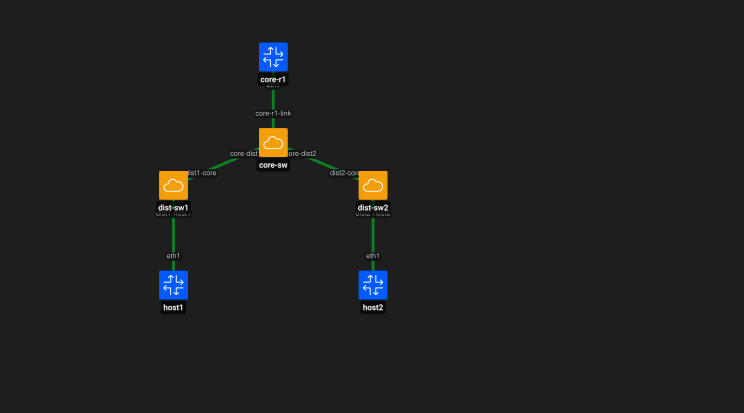

# Containerlab desde cero: Core y Distribución

Esta guía muestra cómo construir una topología con una capa de **core** y una capa de **distribución** utilizando Containerlab, Open vSwitch (OVS), FRRouting (FRR), VLANs, enlaces trunk 802.1Q y routing entre VLANs.

El objetivo es separar funciones dentro de la red y comenzar a trabajar con una arquitectura más cercana a una red empresarial o de evento.

---

# 1. Topología



```text
          core-r1
             |
          core-sw
          /     \
   dist-sw1     dist-sw2
      |            |
    host1         host2
```

Funciones:

```text
Core          -> concentra el tráfico principal
Distribución  -> conecta grupos o zonas
Acceso        -> conecta hosts finales
```

Direccionamiento:

```text
host1 -> VLAN 10 -> 10.10.10.10/24
host2 -> VLAN 20 -> 10.20.20.20/24

core-r1 eth1.10 -> 10.10.10.1/24
core-r1 eth1.20 -> 10.20.20.1/24
```

---

# 2. Crear los bridges OVS

```bash
sudo ovs-vsctl add-br core-sw
sudo ovs-vsctl add-br dist-sw1
sudo ovs-vsctl add-br dist-sw2
```

Verificar:

```bash
sudo ovs-vsctl show
```

---

# 3. Crear la topología

Archivo:

```text
topologies/core-distribucion.clab.yml
```

```yaml
name: core-distribucion

topology:
  nodes:
    core-r1:
      kind: frr
      image: quay.io/frrouting/frr:containerlab-10.7.1

    host1:
      kind: linux
      image: alpine:3.20

    host2:
      kind: linux
      image: alpine:3.20

    core-sw:
      kind: ovs-bridge

    dist-sw1:
      kind: ovs-bridge

    dist-sw2:
      kind: ovs-bridge

  links:
    - endpoints: ["core-r1:eth1", "core-sw:core-r1-link"]

    - endpoints: ["core-sw:core-dist1", "dist-sw1:dist1-core"]
    - endpoints: ["core-sw:core-dist2", "dist-sw2:dist2-core"]

    - endpoints: ["host1:eth1", "dist-sw1:dist1-host1"]
    - endpoints: ["host2:eth1", "dist-sw2:dist2-host2"]
```

---

# 4. Desplegar e inspeccionar

```bash
sudo containerlab deploy -t topologies/core-distribucion.clab.yml
```

```bash
sudo containerlab inspect -t topologies/core-distribucion.clab.yml
```

---

# 5. Verificar puertos OVS

```bash
sudo ovs-vsctl list-ports core-sw
sudo ovs-vsctl list-ports dist-sw1
sudo ovs-vsctl list-ports dist-sw2
```

Esperado:

```text
core-sw:
core-r1-link
core-dist1
core-dist2

dist-sw1:
dist1-core
dist1-host1

dist-sw2:
dist2-core
dist2-host2
```

---

# 6. Configurar VLAN 10

```bash
sudo ovs-vsctl set port dist1-host1 tag=10
sudo ovs-vsctl set port dist1-core trunks=10
sudo ovs-vsctl set port core-dist1 trunks=10
```

---

# 7. Configurar VLAN 20

```bash
sudo ovs-vsctl set port dist2-host2 tag=20
sudo ovs-vsctl set port dist2-core trunks=20
sudo ovs-vsctl set port core-dist2 trunks=20
```

---

# 8. Configurar trunk hacia el router de core

```bash
sudo ovs-vsctl set port core-r1-link trunks=10,20
```

Verificar:

```bash
sudo ovs-vsctl show
```

---

# 9. Crear subinterfaces VLAN en core-r1

Entrar al contenedor:

```bash
docker exec -it clab-core-distribucion-core-r1 sh
```

Crear subinterfaces:

```bash
ip link add link eth1 name eth1.10 type vlan id 10
ip link add link eth1 name eth1.20 type vlan id 20
```

Levantar interfaces:

```bash
ip link set eth1 up
ip link set eth1.10 up
ip link set eth1.20 up
```

Verificar:

```bash
ip -d link show eth1.10
ip -d link show eth1.20
```

Salir:

```bash
exit
```

---

# 10. Configurar gateways en FRR

```bash
docker exec -it clab-core-distribucion-core-r1 vtysh
```

```text
configure terminal

interface eth1.10
 ip address 10.10.10.1/24
 no shutdown
exit

interface eth1.20
 ip address 10.20.20.1/24
 no shutdown
exit

end
show interface brief
```

Salir:

```text
exit
```

---

# 11. Configurar host1

```bash
docker exec clab-core-distribucion-host1 \
  ip addr add 10.10.10.10/24 dev eth1
```

```bash
docker exec clab-core-distribucion-host1 \
  ip route replace default via 10.10.10.1 dev eth1
```

Verificar:

```bash
docker exec clab-core-distribucion-host1 ip addr show eth1
docker exec clab-core-distribucion-host1 ip route
```

---

# 12. Configurar host2

```bash
docker exec clab-core-distribucion-host2 \
  ip addr add 10.20.20.20/24 dev eth1
```

```bash
docker exec clab-core-distribucion-host2 \
  ip route replace default via 10.20.20.1 dev eth1
```

Verificar:

```bash
docker exec clab-core-distribucion-host2 ip addr show eth1
docker exec clab-core-distribucion-host2 ip route
```

---

# 13. Probar host1 contra su gateway

## Forma 1

```bash
docker exec clab-core-distribucion-host1 \
  ping -c 3 10.10.10.1
```

## Forma 2

```bash
docker exec -it clab-core-distribucion-host1 sh
```

Dentro:

```bash
ping 10.10.10.1
```

Detener con:

```text
Ctrl + C
```

Salir:

```bash
exit
```

---

# 14. Probar host2 contra su gateway

## Forma 1

```bash
docker exec clab-core-distribucion-host2 \
  ping -c 3 10.20.20.1
```

## Forma 2

```bash
docker exec -it clab-core-distribucion-host2 sh
```

Dentro:

```bash
ping 10.20.20.1
```

Detener con:

```text
Ctrl + C
```

Salir:

```bash
exit
```

---

# 15. Probar conectividad entre zonas

Desde host1:

```bash
docker exec clab-core-distribucion-host1 \
  ping -c 3 10.20.20.20
```

Modo interactivo:

```bash
docker exec -it clab-core-distribucion-host1 sh
```

Dentro:

```bash
ping 10.20.20.20
```

Detener con `Ctrl + C` y salir con `exit`.

Desde host2:

```bash
docker exec clab-core-distribucion-host2 \
  ping -c 3 10.10.10.10
```

Modo interactivo:

```bash
docker exec -it clab-core-distribucion-host2 sh
```

Dentro:

```bash
ping 10.10.10.10
```

Detener con `Ctrl + C` y salir con `exit`.

---

# 16. Flujo del tráfico

```text
host1
  |
dist-sw1
  |
core-sw
  |
core-r1
  |
core-sw
  |
dist-sw2
  |
host2
```

---

# 17. Guardar configuración FRR

```bash
docker exec -it clab-core-distribucion-core-r1 vtysh
```

```text
write memory
exit
```

---

# 18. Limpieza del laboratorio

Destruir:

```bash
sudo containerlab destroy -t topologies/core-distribucion.clab.yml
```

Verificar contenedores:

```bash
docker ps
```

Revisar OVS:

```bash
sudo ovs-vsctl show
```

Eliminar solo los bridges del laboratorio si siguen existiendo:

```bash
sudo ovs-vsctl --if-exists del-br core-sw
sudo ovs-vsctl --if-exists del-br dist-sw1
sudo ovs-vsctl --if-exists del-br dist-sw2
```

Verificar interfaces residuales:

```bash
ip link | grep -E "core-r1-link|core-dist1|core-dist2|dist1-core|dist1-host1|dist2-core|dist2-host2"
```

Si aparecen pares residuales:

```text
core-dist1 <-> dist1-core
core-dist2 <-> dist2-core
```

Eliminar un extremo de cada par:

```bash
sudo ip link delete core-dist1
sudo ip link delete core-dist2
```

Verificar nuevamente:

```bash
ip link | grep -E "core-r1-link|core-dist1|core-dist2|dist1-core|dist1-host1|dist2-core|dist2-host2"
```

La salida esperada es vacía.

---

# 19. Resultado

```text
Containerlab                     OK
Core                             OK
Distribución                     OK
Open vSwitch                     OK
FRRouting                        OK
VLAN 10                          OK
VLAN 20                          OK
Trunks 802.1Q                    OK
Subinterfaz eth1.10              OK
Subinterfaz eth1.20              OK
Gateway VLAN 10                  OK
Gateway VLAN 20                  OK
Host -> gateway                  OK
Routing entre zonas              OK
Ping directo                     OK
Ping interactivo                 OK
Persistencia FRR                 OK
Limpieza OVS                     OK
Limpieza de interfaces veth      OK
```