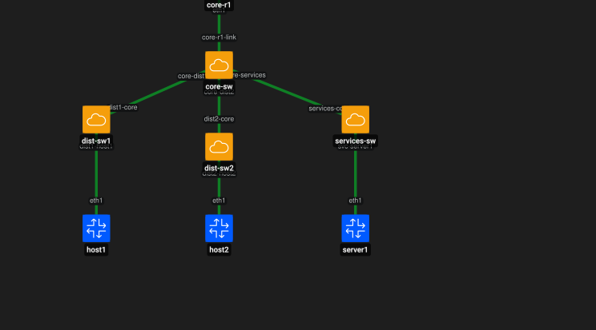

# Containerlab desde cero: Servicios y segmentación

Esta guía muestra cómo agregar una red de servicios separada de las redes de usuarios utilizando:

- Containerlab;
- Open vSwitch (OVS);
- FRRouting (FRR);
- VLANs;
- enlaces trunk 802.1Q;
- routing entre VLANs;
- una zona dedicada para servidores.

El objetivo es representar una red donde los usuarios y los servicios internos se encuentran en segmentos diferentes.

---

# 1. Topología



```text
                 core-r1
                    |
                 core-sw
             /        |        \
        dist-sw1   dist-sw2   services-sw
           |          |           |
         host1      host2       server1
```

Segmentación:

```text
VLAN 10 -> Usuarios zona 1
VLAN 20 -> Usuarios zona 2
VLAN 30 -> Servicios
```

Direccionamiento:

```text
VLAN 10 -> 10.10.10.0/24
VLAN 20 -> 10.20.20.0/24
VLAN 30 -> 10.30.30.0/24
```

Gateways:

```text
eth1.10 -> 10.10.10.1/24
eth1.20 -> 10.20.20.1/24
eth1.30 -> 10.30.30.1/24
```

Servidor:

```text
server1 -> 10.30.30.10/24
```

---

# 2. Crear los bridges OVS

```bash
sudo ovs-vsctl add-br core-sw
sudo ovs-vsctl add-br dist-sw1
sudo ovs-vsctl add-br dist-sw2
sudo ovs-vsctl add-br services-sw
```

Verificar:

```bash
sudo ovs-vsctl show
```

Deberían aparecer:

```text
Bridge core-sw
Bridge dist-sw1
Bridge dist-sw2
Bridge services-sw
```

---

# 3. Crear la topología

Archivo:

```text
topologies/servicios-segmentacion.clab.yml
```

Contenido:

```yaml
name: servicios-segmentacion

topology:
  nodes:
    core-r1:
      kind: frr
      image: quay.io/frrouting/frr:containerlab-10.7.1

    host1:
      kind: linux
      image: alpine:3.20

    host2:
      kind: linux
      image: alpine:3.20

    server1:
      kind: linux
      image: alpine:3.20

    core-sw:
      kind: ovs-bridge

    dist-sw1:
      kind: ovs-bridge

    dist-sw2:
      kind: ovs-bridge

    services-sw:
      kind: ovs-bridge

  links:
    - endpoints: ["core-r1:eth1", "core-sw:core-r1-link"]

    - endpoints: ["core-sw:core-dist1", "dist-sw1:dist1-core"]
    - endpoints: ["core-sw:core-dist2", "dist-sw2:dist2-core"]
    - endpoints: ["core-sw:core-services", "services-sw:services-core"]

    - endpoints: ["host1:eth1", "dist-sw1:dist1-host1"]
    - endpoints: ["host2:eth1", "dist-sw2:dist2-host2"]
    - endpoints: ["server1:eth1", "services-sw:svc-server1"]
```

---

# 4. Desplegar la topología

```bash
sudo containerlab deploy -t topologies/servicios-segmentacion.clab.yml
```

Inspeccionar:

```bash
sudo containerlab inspect -t topologies/servicios-segmentacion.clab.yml
```

---

# 5. Verificar puertos OVS

## core-sw

```bash
sudo ovs-vsctl list-ports core-sw
```

Esperado:

```text
core-r1-link
core-dist1
core-dist2
core-services
```

## dist-sw1

```bash
sudo ovs-vsctl list-ports dist-sw1
```

Esperado:

```text
dist1-core
dist1-host1
```

## dist-sw2

```bash
sudo ovs-vsctl list-ports dist-sw2
```

Esperado:

```text
dist2-core
dist2-host2
```

## services-sw

```bash
sudo ovs-vsctl list-ports services-sw
```

Esperado:

```text
services-core
svc-server1
```

---

# 6. Configurar VLAN 10

```bash
sudo ovs-vsctl set port dist1-host1 tag=10
sudo ovs-vsctl set port dist1-core trunks=10
sudo ovs-vsctl set port core-dist1 trunks=10
```

---

# 7. Configurar VLAN 20

```bash
sudo ovs-vsctl set port dist2-host2 tag=20
sudo ovs-vsctl set port dist2-core trunks=20
sudo ovs-vsctl set port core-dist2 trunks=20
```

---

# 8. Configurar VLAN 30 de servicios

```bash
sudo ovs-vsctl set port svc-server1 tag=30
sudo ovs-vsctl set port services-core trunks=30
sudo ovs-vsctl set port core-services trunks=30
```

El enlace hacia el router de core debe transportar las tres VLANs:

```bash
sudo ovs-vsctl set port core-r1-link trunks=10,20,30
```

Verificar:

```bash
sudo ovs-vsctl show
```

---

# 9. Crear subinterfaces VLAN en core-r1

Entrar:

```bash
docker exec -it clab-servicios-segmentacion-core-r1 sh
```

Crear subinterfaces:

```bash
ip link add link eth1 name eth1.10 type vlan id 10
ip link add link eth1 name eth1.20 type vlan id 20
ip link add link eth1 name eth1.30 type vlan id 30
```

Levantar:

```bash
ip link set eth1 up
ip link set eth1.10 up
ip link set eth1.20 up
ip link set eth1.30 up
```

Verificar:

```bash
ip -d link show eth1.10
ip -d link show eth1.20
ip -d link show eth1.30
```

Salir:

```bash
exit
```

---

# 10. Configurar gateways en FRR

```bash
docker exec -it clab-servicios-segmentacion-core-r1 vtysh
```

Configurar:

```text
configure terminal

interface eth1.10
 ip address 10.10.10.1/24
 no shutdown
exit

interface eth1.20
 ip address 10.20.20.1/24
 no shutdown
exit

interface eth1.30
 ip address 10.30.30.1/24
 no shutdown
exit

end
show interface brief
```

Esperado:

```text
eth1.10   up   default   10.10.10.1/24
eth1.20   up   default   10.20.20.1/24
eth1.30   up   default   10.30.30.1/24
```

Salir:

```text
exit
```

---

# 11. Configurar host1

```bash
docker exec clab-servicios-segmentacion-host1 \
  ip addr add 10.10.10.10/24 dev eth1
```

```bash
docker exec clab-servicios-segmentacion-host1 \
  ip route replace default via 10.10.10.1 dev eth1
```

Verificar:

```bash
docker exec clab-servicios-segmentacion-host1 ip addr show eth1
docker exec clab-servicios-segmentacion-host1 ip route
```

---

# 12. Configurar host2

```bash
docker exec clab-servicios-segmentacion-host2 \
  ip addr add 10.20.20.20/24 dev eth1
```

```bash
docker exec clab-servicios-segmentacion-host2 \
  ip route replace default via 10.20.20.1 dev eth1
```

Verificar:

```bash
docker exec clab-servicios-segmentacion-host2 ip addr show eth1
docker exec clab-servicios-segmentacion-host2 ip route
```

---

# 13. Configurar server1

```bash
docker exec clab-servicios-segmentacion-server1 \
  ip addr add 10.30.30.10/24 dev eth1
```

```bash
docker exec clab-servicios-segmentacion-server1 \
  ip route replace default via 10.30.30.1 dev eth1
```

Verificar:

```bash
docker exec clab-servicios-segmentacion-server1 ip addr show eth1
docker exec clab-servicios-segmentacion-server1 ip route
```

---

# 14. Probar conectividad con los gateways

## host1

### Forma 1

```bash
docker exec clab-servicios-segmentacion-host1 \
  ping -c 3 10.10.10.1
```

### Forma 2

```bash
docker exec -it clab-servicios-segmentacion-host1 sh
```

Dentro:

```bash
ping 10.10.10.1
```

Detener con `Ctrl + C` y salir con:

```bash
exit
```

## host2

### Forma 1

```bash
docker exec clab-servicios-segmentacion-host2 \
  ping -c 3 10.20.20.1
```

### Forma 2

```bash
docker exec -it clab-servicios-segmentacion-host2 sh
```

Dentro:

```bash
ping 10.20.20.1
```

Detener con `Ctrl + C` y salir con `exit`.

## server1

### Forma 1

```bash
docker exec clab-servicios-segmentacion-server1 \
  ping -c 3 10.30.30.1
```

### Forma 2

```bash
docker exec -it clab-servicios-segmentacion-server1 sh
```

Dentro:

```bash
ping 10.30.30.1
```

Detener con `Ctrl + C` y salir con `exit`.

---

# 15. Probar acceso a la red de servicios

## host1 hacia server1

### Forma 1

```bash
docker exec clab-servicios-segmentacion-host1 \
  ping -c 3 10.30.30.10
```

### Forma 2

```bash
docker exec -it clab-servicios-segmentacion-host1 sh
```

Dentro:

```bash
ping 10.30.30.10
```

Detener con `Ctrl + C` y salir con `exit`.

## host2 hacia server1

### Forma 1

```bash
docker exec clab-servicios-segmentacion-host2 \
  ping -c 3 10.30.30.10
```

### Forma 2

```bash
docker exec -it clab-servicios-segmentacion-host2 sh
```

Dentro:

```bash
ping 10.30.30.10
```

Detener con `Ctrl + C` y salir con `exit`.

---

# 16. Segmentación lógica

La topología separa usuarios y servicios:

```text
VLAN 10 -> Usuarios zona 1
VLAN 20 -> Usuarios zona 2
VLAN 30 -> Servicios
```

El routing entre las VLANs se realiza en `core-r1`.

En este punto existe segmentación lógica, pero todavía no existen políticas que restrinjan qué redes pueden acceder a otras.

---

# 17. Problema frecuente: nombre de interfaz demasiado largo

Durante el laboratorio se utilizó inicialmente:

```yaml
- endpoints: ["server1:eth1", "services-sw:services-server1"]
```

El nombre `services-server1` puede superar el límite de longitud disponible para una interfaz Linux.

En ese caso Containerlab puede crear un nombre alternativo similar a:

```text
clab-520a4129
```

Esto provoca que un comando como:

```bash
sudo ovs-vsctl set port services-server1 tag=30
```

no configure el puerto real.

La solución es utilizar un nombre más corto y predecible:

```yaml
- endpoints: ["server1:eth1", "services-sw:svc-server1"]
```

Después la VLAN puede configurarse normalmente:

```bash
sudo ovs-vsctl set port svc-server1 tag=30
```

Verificar:

```bash
sudo ovs-vsctl show
```

---

# 18. Guardar configuración FRR

```bash
docker exec -it clab-servicios-segmentacion-core-r1 vtysh
```

Dentro:

```text
write memory
exit
```

---

# 19. Limpieza del laboratorio

Destruir:

```bash
sudo containerlab destroy -t topologies/servicios-segmentacion.clab.yml
```

Verificar contenedores:

```bash
docker ps
```

Revisar OVS:

```bash
sudo ovs-vsctl show
```

Si continúan los bridges del laboratorio:

```bash
sudo ovs-vsctl --if-exists del-br core-sw
sudo ovs-vsctl --if-exists del-br dist-sw1
sudo ovs-vsctl --if-exists del-br dist-sw2
sudo ovs-vsctl --if-exists del-br services-sw
```

Verificar interfaces residuales:

```bash
ip link | grep -E "core-r1-link|core-dist1|core-dist2|core-services|dist1-core|dist1-host1|dist2-core|dist2-host2|services-core|svc-server1"
```

Si aparecen pares residuales como:

```text
core-services <-> services-core
core-dist1    <-> dist1-core
core-dist2    <-> dist2-core
```

puede eliminarse un extremo de cada par:

```bash
sudo ip link delete core-services
sudo ip link delete core-dist1
sudo ip link delete core-dist2
```

Después verificar nuevamente:

```bash
ip link | grep -E "core-r1-link|core-dist1|core-dist2|core-services|dist1-core|dist1-host1|dist2-core|dist2-host2|services-core|svc-server1"
```

La salida esperada es vacía.

---

# 20. Resultado

```text
Containerlab                     OK
Open vSwitch                     OK
FRRouting                        OK
Core                             OK
Distribución                     OK
VLAN 10                          OK
VLAN 20                          OK
VLAN 30                          OK
Trunks 802.1Q                    OK
Zona de servicios                OK
Subinterfaz eth1.10              OK
Subinterfaz eth1.20              OK
Subinterfaz eth1.30              OK
Gateway VLAN 10                  OK
Gateway VLAN 20                  OK
Gateway VLAN 30                  OK
Host -> gateway                  OK
Usuario -> servicios             OK
Ping directo                     OK
Ping interactivo                 OK
Persistencia FRR                 OK
Troubleshooting de interfaz      OK
Limpieza OVS                     OK
Limpieza de interfaces veth      OK
```