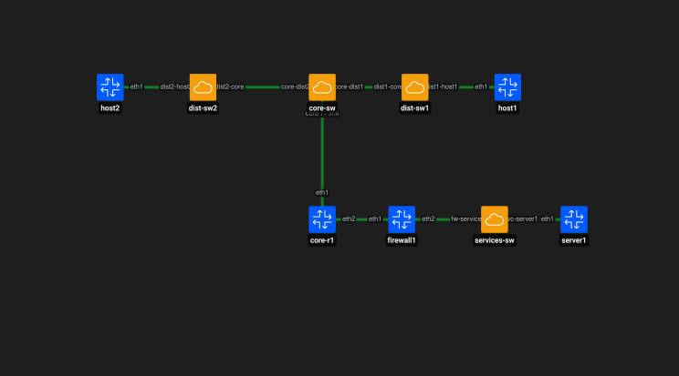

# Containerlab desde cero: Firewall y políticas

Esta guía muestra cómo agregar un firewall dedicado entre las redes de usuarios y la red de servicios.

Se utilizan:

- Containerlab;
- Open vSwitch (OVS);
- FRRouting (FRR);
- Alpine Linux;
- nftables;
- routing estático;
- políticas de filtrado.

El objetivo es pasar de una simple segmentación lógica a una política explícita de seguridad.

---

# 1. Topología



```text
host1 VLAN 10 ----\
                   \
                    core-r1 ---- firewall1 ---- services-sw ---- server1
                   /
host2 VLAN 20 ----/
```

Política objetivo:

```text
VLAN 10 -> server1 : PERMITIDO
VLAN 20 -> server1 : BLOQUEADO
```

Direccionamiento:

```text
VLAN 10
10.10.10.0/24
Gateway: 10.10.10.1

VLAN 20
10.20.20.0/24
Gateway: 10.20.20.1

Tránsito core-r1 <-> firewall1
10.255.0.0/30

core-r1 eth2   -> 10.255.0.1/30
firewall1 eth1 -> 10.255.0.2/30

Red de servicios
10.30.30.0/24

firewall1 eth2 -> 10.30.30.1/24
server1        -> 10.30.30.10/24
```

---

# 2. Crear los bridges OVS

```bash
sudo ovs-vsctl add-br core-sw
sudo ovs-vsctl add-br dist-sw1
sudo ovs-vsctl add-br dist-sw2
sudo ovs-vsctl add-br services-sw
```

Verificar:

```bash
sudo ovs-vsctl show
```

---

# 3. Crear la topología

Archivo:

```text
topologies/firewall-politicas.clab.yml
```

Contenido:

```yaml
name: firewall-politicas

topology:
  nodes:
    core-r1:
      kind: frr
      image: quay.io/frrouting/frr:containerlab-10.7.1

    firewall1:
      kind: linux
      image: alpine:3.20

    host1:
      kind: linux
      image: alpine:3.20

    host2:
      kind: linux
      image: alpine:3.20

    server1:
      kind: linux
      image: alpine:3.20

    core-sw:
      kind: ovs-bridge

    dist-sw1:
      kind: ovs-bridge

    dist-sw2:
      kind: ovs-bridge

    services-sw:
      kind: ovs-bridge

  links:
    - endpoints: ["core-r1:eth1", "core-sw:core-r1-link"]

    - endpoints: ["core-sw:core-dist1", "dist-sw1:dist1-core"]
    - endpoints: ["core-sw:core-dist2", "dist-sw2:dist2-core"]

    - endpoints: ["host1:eth1", "dist-sw1:dist1-host1"]
    - endpoints: ["host2:eth1", "dist-sw2:dist2-host2"]

    - endpoints: ["core-r1:eth2", "firewall1:eth1"]

    - endpoints: ["firewall1:eth2", "services-sw:fw-services"]
    - endpoints: ["server1:eth1", "services-sw:svc-server1"]
```

---

# 4. Desplegar la topología

```bash
sudo containerlab deploy -t topologies/firewall-politicas.clab.yml
```

Inspeccionar:

```bash
sudo containerlab inspect -t topologies/firewall-politicas.clab.yml
```

---

# 5. Verificar puertos OVS

## core-sw

```bash
sudo ovs-vsctl list-ports core-sw
```

Esperado:

```text
core-r1-link
core-dist1
core-dist2
```

## dist-sw1

```bash
sudo ovs-vsctl list-ports dist-sw1
```

Esperado:

```text
dist1-core
dist1-host1
```

## dist-sw2

```bash
sudo ovs-vsctl list-ports dist-sw2
```

Esperado:

```text
dist2-core
dist2-host2
```

## services-sw

```bash
sudo ovs-vsctl list-ports services-sw
```

Esperado:

```text
fw-services
svc-server1
```

---

# 6. Configurar VLAN 10

```bash
sudo ovs-vsctl set port dist1-host1 tag=10
sudo ovs-vsctl set port dist1-core trunks=10
sudo ovs-vsctl set port core-dist1 trunks=10
```

---

# 7. Configurar VLAN 20

```bash
sudo ovs-vsctl set port dist2-host2 tag=20
sudo ovs-vsctl set port dist2-core trunks=20
sudo ovs-vsctl set port core-dist2 trunks=20
```

El trunk hacia `core-r1` transportará solamente VLAN 10 y VLAN 20:

```bash
sudo ovs-vsctl set port core-r1-link trunks=10,20
```

Verificar:

```bash
sudo ovs-vsctl show
```

---

# 8. Configurar core-r1

Entrar al contenedor:

```bash
docker exec -it clab-firewall-politicas-core-r1 sh
```

Crear subinterfaces:

```bash
ip link add link eth1 name eth1.10 type vlan id 10
ip link add link eth1 name eth1.20 type vlan id 20
```

Levantar interfaces:

```bash
ip link set eth1 up
ip link set eth1.10 up
ip link set eth1.20 up
ip link set eth2 up
```

Salir:

```bash
exit
```

Entrar a FRR:

```bash
docker exec -it clab-firewall-politicas-core-r1 vtysh
```

Configurar:

```text
configure terminal

interface eth1.10
 ip address 10.10.10.1/24
 no shutdown
exit

interface eth1.20
 ip address 10.20.20.1/24
 no shutdown
exit

interface eth2
 ip address 10.255.0.1/30
 no shutdown
exit

ip route 10.30.30.0/24 10.255.0.2

end
```

Verificar:

```text
show interface brief
show ip route
```

Se espera una ruta estática hacia:

```text
10.30.30.0/24 via 10.255.0.2
```

Salir:

```text
exit
```

---

# 9. Configurar firewall1

Entrar:

```bash
docker exec -it clab-firewall-politicas-firewall1 sh
```

Asignar direcciones:

```bash
ip addr add 10.255.0.2/30 dev eth1
ip addr add 10.30.30.1/24 dev eth2
```

Levantar interfaces:

```bash
ip link set eth1 up
ip link set eth2 up
```

Habilitar forwarding IPv4:

```bash
sysctl -w net.ipv4.ip_forward=1
```

Verificar:

```bash
ip addr show eth1
ip addr show eth2
sysctl net.ipv4.ip_forward
```

---

# 10. Instalar nftables

Dentro de `firewall1`:

```bash
apk update
apk add nftables
```

Verificar:

```bash
nft --version
```

---

# 11. Verificar conectividad de tránsito

Desde `firewall1`:

```bash
ping -c 3 10.255.0.1
```

Verificar rutas:

```bash
ip route
```

Deberían aparecer las redes conectadas:

```text
10.255.0.0/30 dev eth1
10.30.30.0/24 dev eth2
```

---

# 12. Configurar server1

Entrar:

```bash
docker exec -it clab-firewall-politicas-server1 sh
```

Asignar IP:

```bash
ip addr add 10.30.30.10/24 dev eth1
```

Configurar gateway:

```bash
ip route replace default via 10.30.30.1 dev eth1
```

Verificar:

```bash
ip addr show eth1
ip route
```

Probar gateway:

```bash
ping -c 3 10.30.30.1
```

Salir:

```bash
exit
```

---

# 13. Configurar host1

```bash
docker exec clab-firewall-politicas-host1 \
  ip addr add 10.10.10.10/24 dev eth1
```

```bash
docker exec clab-firewall-politicas-host1 \
  ip route replace default via 10.10.10.1 dev eth1
```

---

# 14. Configurar host2

```bash
docker exec clab-firewall-politicas-host2 \
  ip addr add 10.20.20.20/24 dev eth1
```

```bash
docker exec clab-firewall-politicas-host2 \
  ip route replace default via 10.20.20.1 dev eth1
```

---

# 15. Agregar rutas de retorno en firewall1

Entrar:

```bash
docker exec -it clab-firewall-politicas-firewall1 sh
```

Agregar:

```bash
ip route add 10.10.10.0/24 via 10.255.0.1
ip route add 10.20.20.0/24 via 10.255.0.1
```

Verificar:

```bash
ip route
```

Salir:

```bash
exit
```

---

# 16. Línea base antes del firewall

Antes de aplicar reglas, validar que ambos hosts llegan a `server1`.

## host1 hacia server1

### Forma 1

```bash
docker exec clab-firewall-politicas-host1 \
  ping -c 3 10.30.30.10
```

### Forma 2

```bash
docker exec -it clab-firewall-politicas-host1 sh
```

Dentro:

```bash
ping 10.30.30.10
```

Detener con `Ctrl + C` y salir con `exit`.

## host2 hacia server1

### Forma 1

```bash
docker exec clab-firewall-politicas-host2 \
  ping -c 3 10.30.30.10
```

### Forma 2

```bash
docker exec -it clab-firewall-politicas-host2 sh
```

Dentro:

```bash
ping 10.30.30.10
```

Detener con `Ctrl + C` y salir con `exit`.

En este punto ambos deberían tener conectividad.

---

# 17. Crear política de firewall con nftables

Entrar:

```bash
docker exec -it clab-firewall-politicas-firewall1 sh
```

Limpiar reglas previas:

```bash
nft flush ruleset
```

Crear tabla:

```bash
nft add table inet filter
```

Crear cadena `forward` con política por defecto de bloqueo:

```bash
nft 'add chain inet filter forward { type filter hook forward priority 0; policy drop; }'
```

Permitir tráfico de conexiones ya establecidas:

```bash
nft add rule inet filter forward ct state established,related accept
```

Permitir acceso desde VLAN 10 a servicios:

```bash
nft add rule inet filter forward \
  ip saddr 10.10.10.0/24 ip daddr 10.30.30.0/24 counter accept
```

Agregar bloqueo explícito para VLAN 20:

```bash
nft add rule inet filter forward \
  ip saddr 10.20.20.0/24 ip daddr 10.30.30.0/24 counter drop
```

Verificar:

```bash
nft list ruleset
```

---

# 18. Validar VLAN 10 permitida

## Forma 1

```bash
docker exec clab-firewall-politicas-host1 \
  ping -c 3 10.30.30.10
```

## Forma 2

```bash
docker exec -it clab-firewall-politicas-host1 sh
```

Dentro:

```bash
ping 10.30.30.10
```

Detener con `Ctrl + C` y salir con `exit`.

El tráfico debe atravesar el firewall porque existe una regla `accept` para:

```text
10.10.10.0/24 -> 10.30.30.0/24
```

---

# 19. Validar VLAN 20 bloqueada

## Forma 1

```bash
docker exec clab-firewall-politicas-host2 \
  ping -c 3 10.30.30.10
```

## Forma 2

```bash
docker exec -it clab-firewall-politicas-host2 sh
```

Dentro:

```bash
ping 10.30.30.10
```

Detener con `Ctrl + C` y salir con `exit`.

El tráfico debe ser descartado por la regla:

```text
10.20.20.0/24 -> 10.30.30.0/24 -> drop
```

---

# 20. Verificar contadores

Ejecutar:

```bash
docker exec clab-firewall-politicas-firewall1 \
  nft list chain inet filter forward
```

Las reglas con `counter` muestran la cantidad de paquetes que coincidieron con cada política.

Esto permite observar directamente qué tráfico fue permitido y cuál fue bloqueado.

---

# 21. Segmentación vs política

La segmentación separa redes:

```text
VLAN 10
VLAN 20
Red de servicios
```

El firewall agrega una decisión explícita:

```text
VLAN 10 -> Servicios : ACCEPT
VLAN 20 -> Servicios : DROP
Retorno de conexiones permitidas : ACCEPT
Resto del tráfico forward : DROP
```

---

# 22. Persistencia

Guardar FRR:

```bash
docker exec -it clab-firewall-politicas-core-r1 vtysh
```

Dentro:

```text
write memory
exit
```

Las reglas de `nftables` cargadas manualmente dentro del contenedor no quedan persistidas automáticamente cuando el contenedor es destruido.

Por eso deben documentarse o automatizarse para reproducirlas en cada despliegue.

---

# 23. Limpieza del laboratorio

Destruir:

```bash
sudo containerlab destroy -t topologies/firewall-politicas.clab.yml
```

Verificar:

```bash
docker ps
```

Revisar OVS:

```bash
sudo ovs-vsctl show
```

Eliminar únicamente los bridges de este laboratorio si continúan existiendo:

```bash
sudo ovs-vsctl --if-exists del-br core-sw
sudo ovs-vsctl --if-exists del-br dist-sw1
sudo ovs-vsctl --if-exists del-br dist-sw2
sudo ovs-vsctl --if-exists del-br services-sw
```

Verificar interfaces residuales:

```bash
ip link | grep -E "core-r1-link|core-dist1|core-dist2|dist1-core|dist1-host1|dist2-core|dist2-host2|fw-services|svc-server1"
```

Si aparecen pares residuales:

```text
core-dist1 <-> dist1-core
core-dist2 <-> dist2-core
```

eliminar un extremo de cada par:

```bash
sudo ip link delete core-dist1
sudo ip link delete core-dist2
```

Verificar nuevamente:

```bash
ip link | grep -E "core-r1-link|core-dist1|core-dist2|dist1-core|dist1-host1|dist2-core|dist2-host2|fw-services|svc-server1"
```

La salida esperada es vacía.

---

# 24. Resultado

```text
Containerlab                     OK
Open vSwitch                     OK
FRRouting                        OK
Firewall dedicado                OK
nftables                         OK
VLAN 10                          OK
VLAN 20                          OK
Red de servicios                 OK
Routing estático                 OK
Forwarding IPv4                  OK
Baseline sin filtrado            OK
VLAN 10 -> Servicios             ACCEPT
VLAN 20 -> Servicios             DROP
Established/related              ACCEPT
Contadores nftables              OK
Persistencia FRR                 OK
Limpieza OVS                     OK
Limpieza de interfaces veth      OK
```